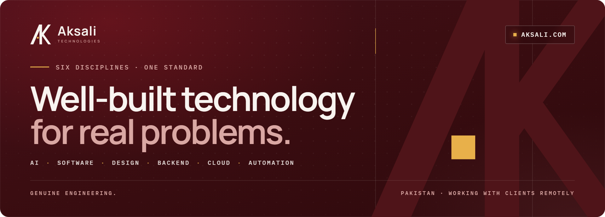
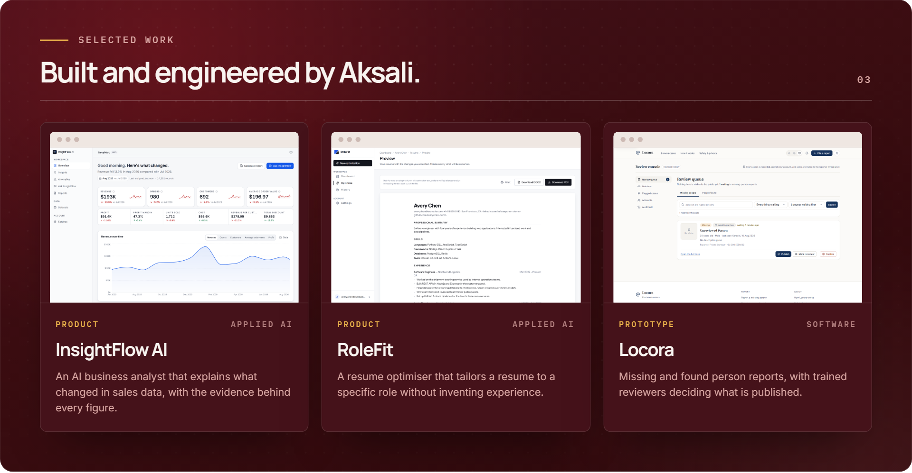
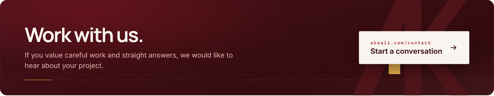

 

  <b>Aksali Technologies</b> builds AI systems, software, interfaces, backends, cloud and automation 
  around the problem in front of us. We choose the simplest technology that solves it, 
  and we check that it actually works.

  
  
  
  

GENUINE ENGINEERING · PAKISTAN · WORKING WITH CLIENTS REMOTELY

---

---

---

## How we work

<table>
  <tr>
    <td width="33%" valign="top">
      <h3>01 · Straight answers</h3>
      An honest view of the approach, the risks and the cost of complexity, including when you do not need us.
    </td>
    <td width="33%" valign="top">
      <h3>02 · Evidence, not claims</h3>
      We show how a system performs and where its limits are, measured rather than promised.
    </td>
    <td width="33%" valign="top">
      <h3>03 · Yours to keep</h3>
      The code, the documentation and the knowledge to run it are handed over, so you are never locked in.
    </td>
  </tr>
</table>

---

## Tools we build with

  

Also: pandas · Drizzle ORM · Zod · Playwright. We pick the simplest tool that solves the problem, not the newest one.

---

  Project and business enquiries: <a href="https://aksali.com/contact">aksali.com/contact</a> · +92 309 6616280

---
