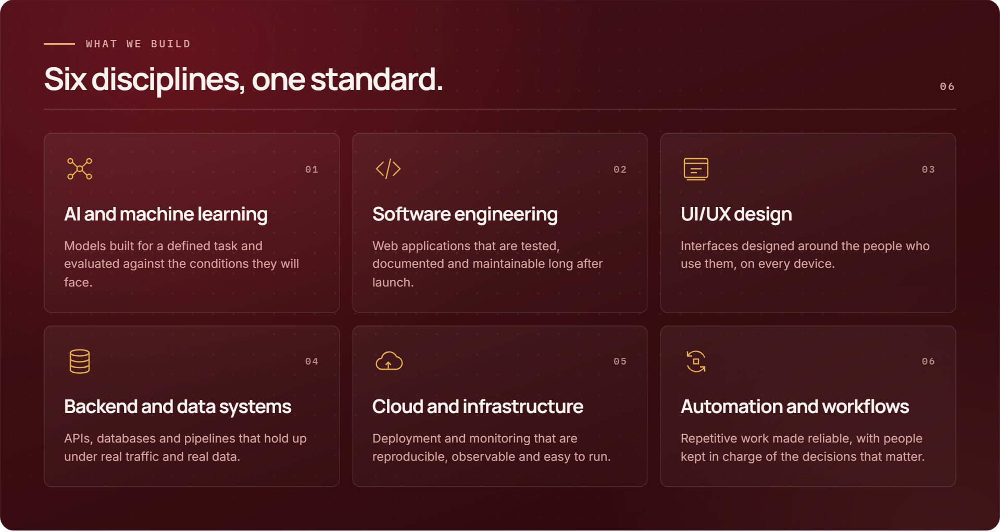
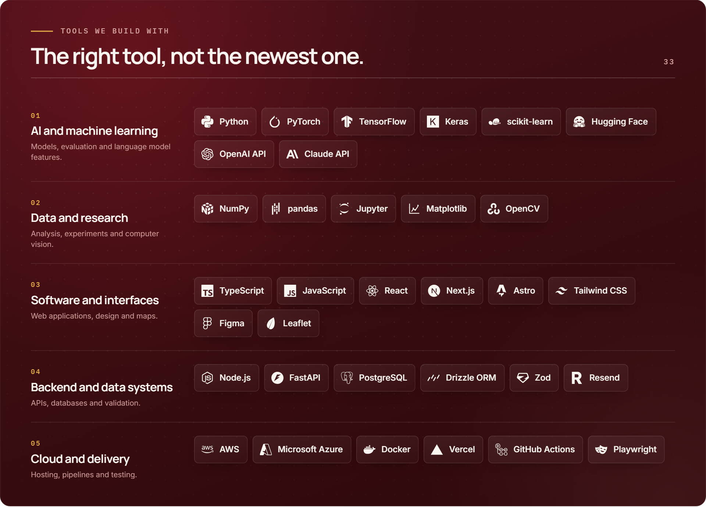

<h3 align="center">AI, software, design, backend, cloud and automation engineering, built carefully.</h3>

  We build technology around the problem in front of us, choose the simplest tool that solves it, 
  and check that it actually works before anyone relies on it.

  
  
  
  
  

  <a href="#about-aksali"><b>About</b></a> &nbsp;·&nbsp;
  <a href="#what-we-build"><b>What we build</b></a> &nbsp;·&nbsp;
  <a href="#selected-work"><b>Selected work</b></a> &nbsp;·&nbsp;
  <a href="#how-we-work"><b>How we work</b></a> &nbsp;·&nbsp;
  <a href="#tools-we-build-with"><b>Tools</b></a> &nbsp;·&nbsp;
  <a href="#start-a-conversation"><b>Contact</b></a>

 

## About Aksali

**Aksali Technologies** is an engineering studio from Pakistan, working with clients remotely. We design and build AI systems, web software, interfaces, backends, cloud infrastructure and automation, and we treat all six as one discipline: **engineering that holds up after launch.**

Most software fails quietly. A model that looked accurate in a demo, a dashboard whose figures nobody can trace, a system only its author understands. We build the opposite: systems whose results can be checked, whose limits are written down, and whose code is handed over in a state someone else can run.

> **Our standard.** If a rule, a query or a simple script solves the problem, we use that. AI is for problems that need it. Every result we report is measured, never assumed, including the ones that complicate the story.

<table>
  <tr>
    <td align="center" width="25%"><h3>6</h3>ENGINEERING DISCIPLINES</td>
    <td align="center" width="25%"><h3>5</h3>STEPS FROM BRIEF TO HAND-OVER</td>
    <td align="center" width="25%"><h3>100%</h3>OF THE CODE HANDED OVER TO YOU</td>
    <td align="center" width="25%"><h3>0</h3>ACCOUNT MANAGERS BETWEEN YOU AND THE ENGINEERS</td>
  </tr>
</table>

 

## What we build

Six disciplines under one standard of engineering. Most projects draw on several at once: a model needs an API, an API needs an interface, and all of it needs somewhere reliable to run.

| Discipline | What you get | |
| :-- | :-- | :-: |
| **AI and machine learning** | Models and AI features built for a defined task, evaluated against the conditions they will face, and deployed only where they genuinely add value | [Explore →](https://aksali.com/services/ai-machine-learning) |
| **Software engineering** | Web applications, dashboards and internal tools with clean architecture, sensible tests and code your team can keep building on | [Explore →](https://aksali.com/services/software-engineering) |
| **UI/UX design** | Interfaces designed around the task people are trying to complete, with accessibility to WCAG 2.2 AA and the same team designing and building | [Explore →](https://aksali.com/services/ui-ux-design) |
| **Backend and data systems** | APIs, databases and data pipelines that hold up under real traffic and real data. The part users never see, and always depend on | [Explore →](https://aksali.com/services/backend-data-systems) |
| **Cloud and infrastructure** | Deployment, hosting and delivery pipelines sized to the problem, so releases are routine and problems surface before users find them | [Explore →](https://aksali.com/services/cloud-infrastructure) |
| **Automation and workflows** | Repetitive work turned into reliable workflows, with AI used only for the steps that need judgement and people kept in charge of the decisions that matter | [Explore →](https://aksali.com/services/automation-workflows) |

 

## Selected work

Products we have built and engineered, each shown for what it is: a working system or a prototype. Every one starts from the same question: **what would make this output safe to act on?**

### InsightFlow AI &nbsp;<code>PRODUCT</code> · <code>APPLIED AI</code> · <code>DATA ANALYTICS</code>

An AI business analyst for small businesses that explains what changed in their sales data, with the evidence behind every figure.

**The problem.** Tools that hand a spreadsheet to a language model return fluent answers whose figures may be wrong, and a wrong figure looks exactly like a right one.

**What we built.** A deterministic analytics engine computes every metric, trend and anomaly. The language model is only allowed to phrase what the engine found, and every answer carries its evidence.

- A validator discards any model response containing a figure the engine did not compute. The rule is enforced in code, not requested in a prompt.
- The model never sees the rows of the file, and every analysis still works with the AI switched off.
- **300 backend tests**, including an adversarial suite that feeds the guardrails exactly what a misbehaving model would produce.

`Next.js` `TypeScript` `FastAPI` `pandas` `scikit-learn` `PostgreSQL` &nbsp; **[Open the live app →](https://insight-flow-ai-iota.vercel.app)**

### RoleFit &nbsp;<code>PRODUCT</code> · <code>APPLIED AI</code> · <code>SOFTWARE</code>

A resume optimiser that tailors a resume to a specific role **without inventing experience**.

**The problem.** AI resume tools add whatever a job posting asks for, including skills the candidate does not have. The result reads well and cannot be defended in an interview.

**What we built.** RoleFit scores the match across seven weighted dimensions and proposes rewrites the user accepts or rejects one by one. Anything the resume cannot evidence is listed as a gap, never written in.

- An anti-fabrication validator rejects any rewrite that adds a skill, metric or employer not in the source resume, **tested by 27 adversarial cases**.
- The readiness score is deterministic arithmetic, not a model opinion: the same inputs always produce the same number.
- Works without any AI provider. Exports are read back and verified before download.

`Next.js` `TypeScript` `PostgreSQL` `Drizzle ORM` `Zod` `Playwright` &nbsp; **[Open the live app →](https://rolefit-topaz.vercel.app)**

### Locora &nbsp;<code>PROTOTYPE</code> · <code>SOFTWARE</code> · <code>BACKEND SYSTEMS</code>

A platform where families and the public report missing and found people, and **trained reviewers** decide what is published.

**The problem.** Reuniting people looks like a matching problem, which is the trap. A false match means a family is told something untrue.

**What we built.** A review queue where nothing publishes itself, and a match builder that ranks candidates by reasons stated in words rather than a percentage. Every reviewer action is written to an append-only audit trail.

- Public queries never select contact columns at all, so a column added later cannot leak by default.
- A case that is not public answers 404, never 403, because a 403 would confirm the case exists.
- Integration tests are written as **attacks against a real PostgreSQL database**.

`Next.js` `TypeScript` `PostgreSQL` `Drizzle ORM` `Zod` `Leaflet` &nbsp; **[Read the case study →](https://aksali.com/work)**

 

## How we work

Four principles decide every technical choice we make.

<table>
  <tr>
    <td width="50%" valign="top">
      <code>01 · DEFINE</code>
      <h3>Problem first</h3>
      We define what success looks like before choosing a single tool.
    </td>
    <td width="50%" valign="top">
      <code>02 · SELECT</code>
      <h3>AI where it earns its place</h3>
      If a rule, a query or a simple script solves it, we use that. AI is for problems that need it.
    </td>
  </tr>
  <tr>
    <td width="50%" valign="top">
      <code>03 · VERIFY</code>
      <h3>Measured, not assumed</h3>
      We test models and systems against real conditions and report results honestly, including the ones that complicate the story.
    </td>
    <td width="50%" valign="top">
      <code>04 · HAND OVER</code>
      <h3>Built to be maintained</h3>
      Clear code, documentation and hand-over, so the system outlives the project.
    </td>
  </tr>
</table>

### How a project runs

  <b>Understand</b> &nbsp;→&nbsp; <b>Scope</b> &nbsp;→&nbsp; <b>Build</b> &nbsp;→&nbsp; <b>Verify</b> &nbsp;→&nbsp; <b>Hand over</b>

| Step | What happens |
| :-- | :-- |
| **01 · Understand** | We learn the problem, the users and the constraints, and agree what success means. |
| **02 · Scope** | You receive a written plan: what we will build, how, and what it will take. |
| **03 · Build** | We work in short increments and show working software early and often. |
| **04 · Verify** | We test the system against real conditions and report the results honestly, limits included. |
| **05 · Hand over** | You receive the code, documentation and everything needed to run and extend the system. |

 

## Tools we build with

We are not loyal to a framework. We are loyal to the problem, and pick the simplest tool that solves it well. These are the 33 we reach for most.

<b>See the full list as text</b>

 

| Area | Tools |
| :-- | :-- |
| **AI and machine learning** | Python · PyTorch · TensorFlow · Keras · scikit-learn · Hugging Face · OpenAI API · Claude API |
| **Data and research** | NumPy · pandas · Jupyter · Matplotlib · OpenCV |
| **Software and interfaces** | TypeScript · JavaScript · React · Next.js · Astro · Tailwind CSS · Figma · Leaflet |
| **Backend and data systems** | Node.js · FastAPI · PostgreSQL · Drizzle ORM · Zod · Resend |
| **Cloud and delivery** | AWS · Microsoft Azure · Docker · Vercel · GitHub Actions · Playwright |

 

## Start a conversation

You do not need a technical specification. A clear description of what is not working, or what you want to exist, is the best place to start.

**What happens next**

1. We read your message and reply personally.
2. If it looks like a good fit, we arrange a short call to understand the problem.
3. You receive an honest view of the approach, including whether you need us at all.

| | |
| :-- | :-- |
| **Website** | [aksali.com](https://aksali.com) |
| **Enquiries** | [aksali.com/contact](https://aksali.com/contact) |
| **Email** | [hello@aksali.com](mailto:hello@aksali.com) |
| **Phone** | +92 309 6616280 |
| **LinkedIn** | [Aksali Technologies](https://www.linkedin.com/company/aksali-technologies) |
| **Instagram** | [@aksali.technologies](https://www.instagram.com/aksali.technologies/) |
| **Facebook** | [Aksali Technologies](https://www.facebook.com/profile.php?id=61595649561837) |
| **Time zone** | Pakistan Standard Time (UTC+5) |

 

  <b>AKSALI TECHNOLOGIES</b> &nbsp;·&nbsp; GENUINE ENGINEERING. &nbsp;·&nbsp; PAKISTAN, WORKING WITH CLIENTS REMOTELY

