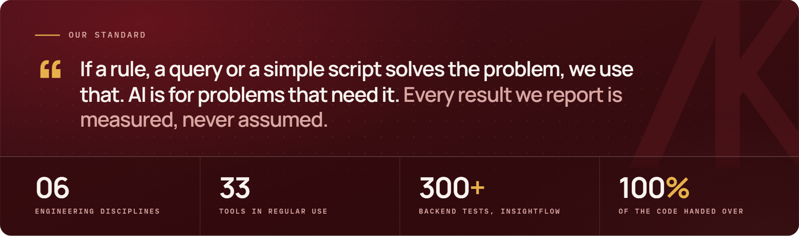
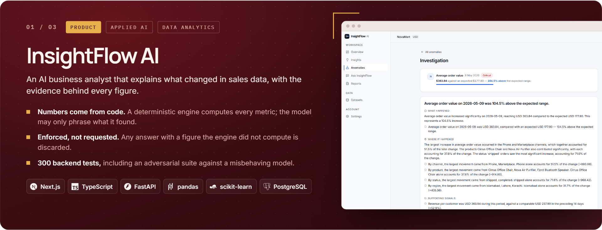
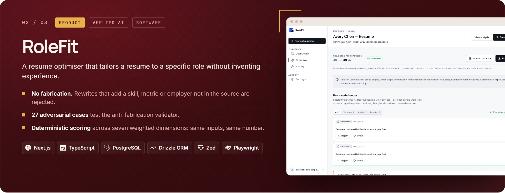
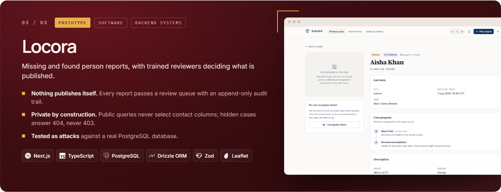
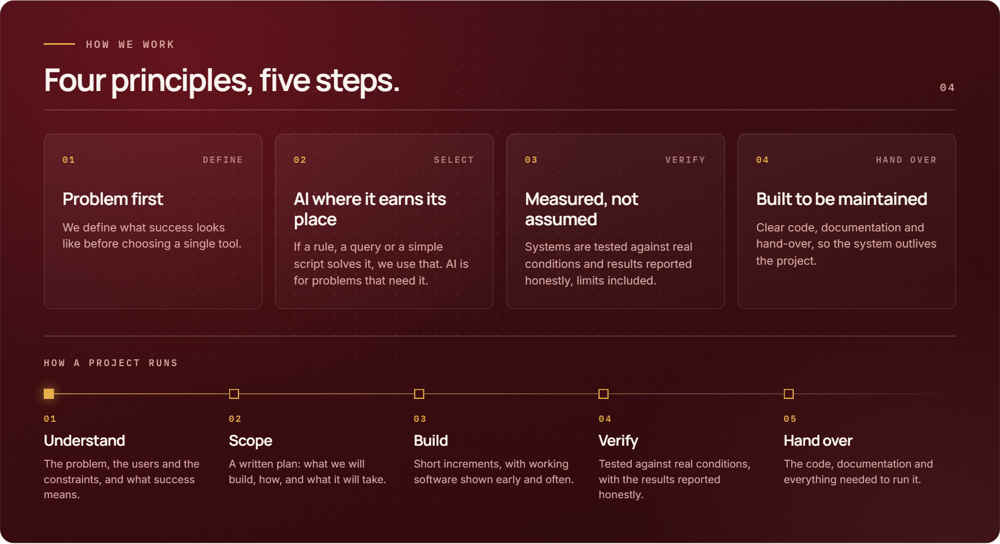
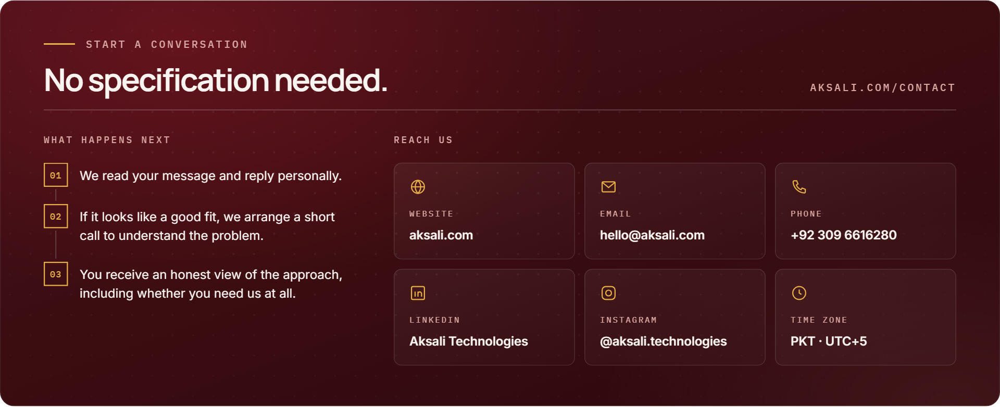
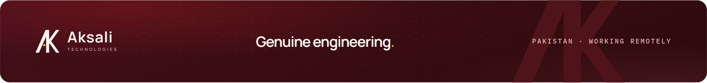

 

**An engineering studio for AI, software, design, backend, cloud and automation.** 
We start from the problem, choose the simplest tool that solves it, and prove it works before anyone relies on it.

 

<a href="#what-we-build">What we build</a> &nbsp;·&nbsp;
<a href="#selected-work">Selected work</a> &nbsp;·&nbsp;
<a href="#how-we-work">How we work</a> &nbsp;·&nbsp;
<a href="#tools-we-build-with">Tools</a> &nbsp;·&nbsp;
<a href="#work-with-us">Contact</a>

 

---

## What we build

Six disciplines, one standard: **engineering that holds up after launch.** Most projects draw on several at once. A model needs an API, an API needs an interface, and all of it needs somewhere reliable to run.

<a href="https://aksali.com/services/ai-machine-learning">AI &amp; ML</a> &nbsp;·&nbsp;
<a href="https://aksali.com/services/software-engineering">Software</a> &nbsp;·&nbsp;
<a href="https://aksali.com/services/ui-ux-design">UI/UX design</a> &nbsp;·&nbsp;
<a href="https://aksali.com/services/backend-data-systems">Backend &amp; data</a> &nbsp;·&nbsp;
<a href="https://aksali.com/services/cloud-infrastructure">Cloud</a> &nbsp;·&nbsp;
<a href="https://aksali.com/services/automation-workflows">Automation</a>

---

## Selected work

Every project starts from the same question: **what would make this output safe to act on?**

  

  

  

<a href="https://aksali.com/work"><b>Read the full case studies →</b></a>

---

## How we work

---

## Tools we build with

Loyal to the problem, not to a framework. These are the 33 tools we reach for most.

View as text

 

**AI and machine learning** · Python, PyTorch, TensorFlow, Keras, scikit-learn, Hugging Face, OpenAI API, Claude API 
**Data and research** · NumPy, pandas, Jupyter, Matplotlib, OpenCV 
**Software and interfaces** · TypeScript, JavaScript, React, Next.js, Astro, Tailwind CSS, Figma, Leaflet 
**Backend and data systems** · Node.js, FastAPI, PostgreSQL, Drizzle ORM, Zod, Resend 
**Cloud and delivery** · AWS, Microsoft Azure, Docker, Vercel, GitHub Actions, Playwright

---

## Work with us

  

  <a href="https://aksali.com/contact"><b>aksali.com/contact</b></a> &nbsp;·&nbsp;
  <a href="mailto:hello@aksali.com">hello@aksali.com</a> &nbsp;·&nbsp;
  <a href="https://www.linkedin.com/company/aksali-technologies">LinkedIn</a> &nbsp;·&nbsp;
  <a href="https://www.instagram.com/aksali.technologies/">Instagram</a>

---

